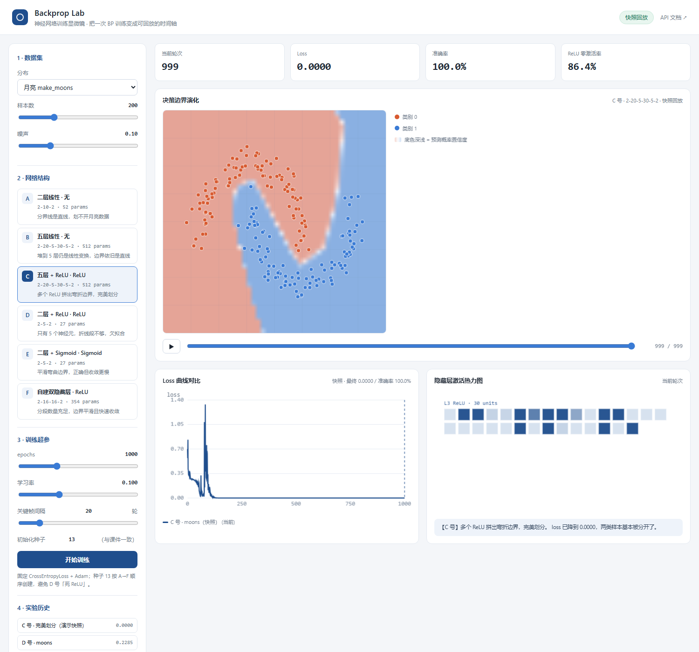
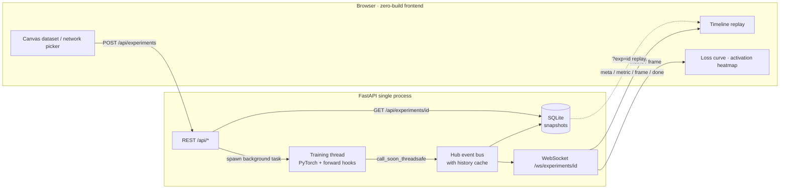

<div align="center">

# Backprop Lab

**Turn the internal state of a BP training run into a scrubbable, replayable, comparable timeline.**

[中文](./README.md) · [Live Demo](https://bp-training-microscope.app.workbuddy.host/?sharecode=QQUVVFCKMQ) · [API](#api) · [Deployment](#deployment)


</div>



---

## The problem

Neural-network visualizations are everywhere, but almost all of them show **one static decision boundary after training**. They cannot answer the interesting questions: *why is a 5-layer linear stack still a straight line? At which epoch did ReLU start bending the boundary? Did half the neurons in network D die?*

Backprop Lab treats the training process itself as a first-class object. During the PyTorch loop, the backend collects per-epoch loss, accuracy, gradient norm, per-layer activations, and a 48×48 decision-probability grid, then streams everything over WebSocket. The frontend caches it as a timeline you can scrub back to epoch 37 and watch a straight line slowly fold into a moon-shaped boundary.

It is also a portfolio project you can actually defend in an interview: instead of saying "I tuned a model", you can demonstrate why stacked `Linear` layers collapse into one linear transform, why ReLU introduces piecewise linearity, why 5 hidden neurons underfit, and how a repeated seed causes dead ReLUs.

## Features

| | |
| --- | --- |
| **4 datasets** | `make_moons`, concentric circles, XOR, and **freehand Canvas drawing** (left click = red class, right click = blue) |
| **6 networks** | A–F `nn.Sequential` variants: no activation, deep-linear, ReLU, Sigmoid, two hidden layers |
| **Live stream** | Per-epoch WebSocket events: loss / acc / grad norm / ReLU zero-activation rate / layer activations |
| **Timeline replay** | Scrubbable and playable decision-boundary keyframes — watch straight → kinked → curved |
| **Diagnostics** | Overlaid loss curves, activation heatmap, automatic hints for dead ReLU and vanishing gradients |
| **Snapshots** | Everything persisted in SQLite; `?exp=<id>` replays an experiment without retraining |
| **Instant demo** | `?auto=1&net=C` starts a run on page load — handy for GIFs and live demos |

## Quick start

```bash
git clone https://github.com/anshu-lgtm/backprop-lab.git
cd backprop-lab

python -m venv .venv
# Windows: .venv\Scripts\activate     macOS/Linux: source .venv/bin/activate
pip install -r requirements.txt

python run.py
```

Open `http://127.0.0.1:8000` (auto-opened), Swagger docs at `/docs`. Use `PORT=8765 python run.py` for a different port, `--no-browser` to disable auto-open.

> **Zero-build frontend.** Plain HTML/CSS/JS + Canvas served by FastAPI `StaticFiles`. No `npm install`, no bundler — one command from clone to running app.

## Benchmark results

`make_moons(n_samples=200, noise=0.1, random_state=42)`, `CrossEntropyLoss + Adam(lr=0.1)`, 1000 epochs, global seed 13, networks created in A→F order.

| Net | Shape | Activation | Final loss | Accuracy | Boundary |
| --- | --- | --- | --- | --- | --- |
| A | 2-10-2 | none | 0.2721 | 86.5% | straight line |
| B | 2-20-5-30-5-2 | none | 0.2721 | 86.5% | still a straight line |
| C | 2-20-5-30-5-2 | ReLU | 0.0000 | 100% | perfect separation |
| D | 2-5-2 | ReLU | 0.2285 | 89.0% | kinked, underfitting |
| E | 2-5-2 | Sigmoid | 0.0006 | 100% | smooth curve |
| F | 2-16-16-2 | ReLU ×2 | 0.0000 | 100% | smooth curve |

Three comparisons carry the whole project: **A vs B** (composing `Linear` layers still yields one linear map `W = W₂W₁`), **B vs C** (a single `nn.ReLU()` enables piecewise-linear boundaries), **D vs E** (too few hidden neurons underfit; Sigmoid is smooth but converges slower).

## Architecture



### Implementation highlights

1. **Thread ↔ event loop bridge.** Training runs in a dedicated thread; events are posted back to the asyncio loop with `loop.call_soon_threadsafe` and broadcast by the Hub. The Hub keeps a history buffer, so late subscribers, page refreshes and multiple tabs never miss data.
2. **Boundaries are probability grids, not screenshots.** Each keyframe computes `P(class=1)` on a 48×48 grid, quantizes it to `uint8`, stores it as a BLOB and sends it as base64 (~2.3 KB/frame). The frontend upscales via `ImageData`, producing smooth confidence gradients instead of hard class blocks. One frame every 20 epochs, auto-thinned to at most 200 frames ≈ 150 KB for a 1000-epoch run.
3. **Quantifying dead ReLUs.** `register_forward_hook` captures activation outputs; the zero-activation ratio is measured per epoch and persisted. "Half of network D died" becomes a measurable curve.
4. **Reproducibility has a real cost here.** `torch.manual_seed(13)` is set exactly once and the RNG advances naturally as networks A→F are created. An earlier version reseeded before *each* network — network D's ReLUs then output nothing but zeros, loss stuck at 0.6931 and accuracy at 50%. Two unit tests lock this behaviour down.

## API

| Method | Path | Description |
| --- | --- | --- |
| `GET`  | `/api/health`                                  | Health probe for deploy platforms             |
| `GET` | `/api/networks` | Catalog of networks A–F |
| `GET` | `/api/datasets/{kind}?n_samples=200&noise=0.1` | Dataset preview points + grid metadata |
| `POST` | `/api/experiments` | Create experiment and start background training |
| `GET` | `/api/experiments?limit=50` | Experiment list |
| `GET` | `/api/experiments/{id}` | Full snapshot (metrics / frames / activations) for replay |
| `WS` | `/ws/experiments/{id}` | Streaming events |

```json
{
  "network": "C",
  "dataset": "moons",
  "n_samples": 200,
  "noise": 0.1,
  "epochs": 1000,
  "lr": 0.1,
  "seed": 13,
  "data_seed": 42,
  "frame_every": 20,
  "grid_size": 48,
  "name": "Network C · perfect separation"
}
```

WebSocket sequence: `meta` → `metric` × N (one per epoch) → `frame` (interleaved with metrics) → `done` / `error`.

SQLite tables (generated at `data/lab.sqlite3`, gitignored): `experiments`, `metrics` `(exp_id, epoch)`, `frames` `(exp_id, epoch)`, `activations` `(exp_id, epoch)`. Metrics are flushed in batches of 100.

## Tests

```bash
python -m unittest discover -s tests -v
```

8 unit tests: dataset shapes, two-class validation for custom data, grid orientation, forward shapes, reproducible initialization, parameter counts, short-run event/persistence pipeline, linear-model boundary stays linear.

[Enable CI with one click](https://github.com/anshu-lgtm/backprop-lab/new/main?filename=.github/workflows/ci.yml&value=name%3A%20CI%0A%0Aon%3A%0A%20%20push%3A%0A%20%20%20%20branches%3A%20%5Bmain%2C%20master%5D%0A%20%20pull_request%3A%0A%20%20workflow_dispatch%3A%0A%0Ajobs%3A%0A%20%20test%3A%0A%20%20%20%20runs-on%3A%20ubuntu-latest%0A%20%20%20%20timeout-minutes%3A%2020%0A%20%20%20%20env%3A%0A%20%20%20%20%20%20PYTHONPATH%3A%20.%0A%20%20%20%20%20%20MPLBACKEND%3A%20Agg%0A%20%20%20%20steps%3A%0A%20%20%20%20%20%20-%20uses%3A%20actions%2Fcheckout%40v4%0A%0A%20%20%20%20%20%20-%20uses%3A%20actions%2Fsetup-python%40v5%0A%20%20%20%20%20%20%20%20with%3A%0A%20%20%20%20%20%20%20%20%20%20python-version%3A%20%223.11%22%0A%20%20%20%20%20%20%20%20%20%20cache%3A%20pip%0A%0A%20%20%20%20%20%20%23%20CPU-only%20wheel%3A%20the%20default%20PyPI%20torch%20wheel%20pulls%20in%20several%20GB%20of%20CUDA%20deps.%0A%20%20%20%20%20%20-%20name%3A%20Install%20CPU-only%20PyTorch%0A%20%20%20%20%20%20%20%20run%3A%20pip%20install%20torch%20--index-url%20https%3A%2F%2Fdownload.pytorch.org%2Fwhl%2Fcpu%0A%0A%20%20%20%20%20%20-%20name%3A%20Install%20dependencies%0A%20%20%20%20%20%20%20%20run%3A%20pip%20install%20-r%20requirements.txt%0A%0A%20%20%20%20%20%20-%20name%3A%20Run%20unit%20tests%0A%20%20%20%20%20%20%20%20run%3A%20python%20-m%20unittest%20discover%20-s%20tests%20-v%0A%0A%20%20%20%20%20%20-%20name%3A%20Verify%20application%20imports%20and%20routes%0A%20%20%20%20%20%20%20%20run%3A%20python%20-c%20%22from%20backend.app%20import%20app%3B%20print%28%27routes%3A%27%2C%20len%28app.routes%29%29%22%0A%0A%20%20%20%20%20%20-%20name%3A%20Compile%20all%20sources%0A%20%20%20%20%20%20%20%20run%3A%20python%20-m%20compileall%20-q%20backend%20run.py%0A) — this opens GitHub's "Create new file" page with the path `.github/workflows/ci.yml` and its content pre-filled; just scroll down and commit. CI runs the 8 tests on every push/PR and installs CPU-only torch first to avoid multi-GB CUDA wheels. The config is also kept at `docs/ci.yml.example`.

> Note: GitHub requires the `workflow` scope on a Personal Access Token to create or modify files under `.github/workflows/`; the publishing token only had `repo`, so the config ships as an example file. The web link above enables CI without issuing a new token. With a `workflow`-scoped token you can also `cp docs/ci.yml.example .github/workflows/ci.yml` and commit locally.

## Deployment

**Live demo (no install, just open it)**: https://bp-training-microscope.app.workbuddy.host/?sharecode=QQUVVFCKMQ

Pick a network and click *Start training* for the live stream; append `&auto=1&net=C` for an instant demo or `&exp=<id>` to replay a saved experiment. Experiments A–F are preloaded on the cloud instance.

> This is a dynamic FastAPI app, **not** a static site — GitHub Pages cannot host it. Self-hosting a permanent instance needs a Python-capable host.

```bash
docker build -t backprop-lab .
docker run -p 8000:8000 backprop-lab
```

`run.py` binds `127.0.0.1` locally and switches to `0.0.0.0` automatically when the platform injects `PORT` (Docker / PaaS / deploy sandbox); override with `HOST`. `/api/health` is available for platform probes. When reverse-proxying, allow WebSocket upgrade (Nginx: `proxy_set_header Upgrade $http_upgrade;` + `Connection "upgrade"`). Training is an in-process thread, so the app is a stateful single instance — multi-replica deployments should swap the Hub for Redis Pub/Sub and move training to Celery/RQ. Mount a volume for SQLite or snapshots vanish on restart.

## Roadmap

- [ ] Drag-and-drop layer builder
- [ ] Shareable experiment links with auth
- [ ] PDF experiment report export
- [ ] React + TS + Vite frontend (backend unchanged)
- [ ] Side-by-side comparison view and Celery-based concurrent training

## License

[MIT](./LICENSE) © 2026 Backprop Lab contributors
