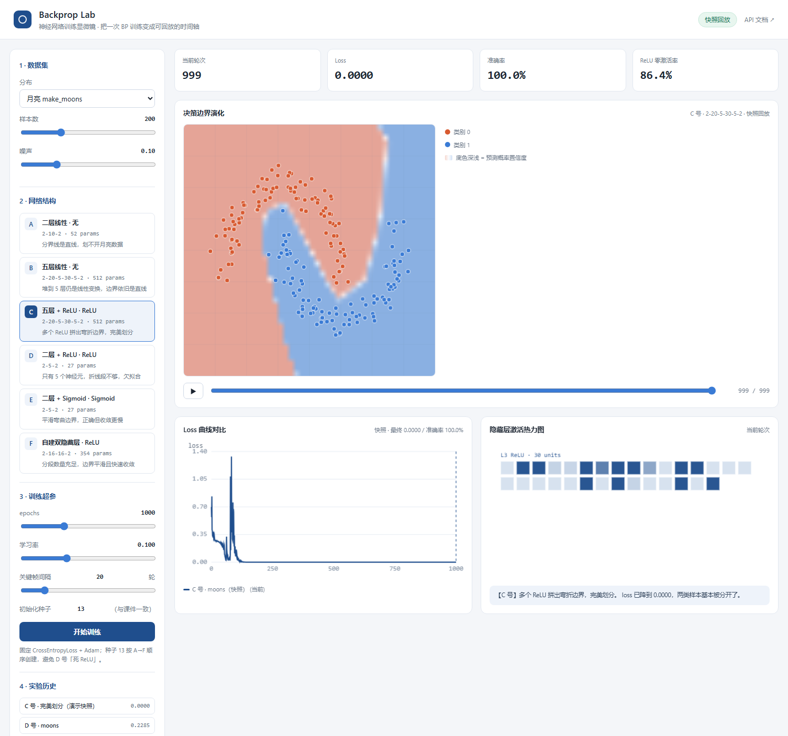
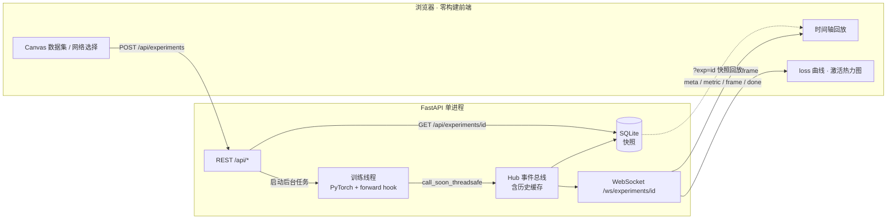

<div align="center">

# Backprop Lab · 神经网络训练显微镜

**把一次 BP 训练的「内部状态」变成可拖动、可回放、可对比的时间轴**

[English](./README.en.md) · [在线 Demo](https://bp-training-microscope.app.workbuddy.host/?sharecode=QQUVVFCKMQ) · [API 文档](#api) · [部署说明](#部署)


</div>



> 截图为真实运行结果（无头 Chrome 渲染），C 号网络 1000 轮后 loss 0.0000、准确率 100%。

---

## 为什么要做这个

神经网络可视化的教程很多，但绝大多数只展示**训练结束后的一张决策边界图**。「为什么 B 号堆到 5 层还是一条直线」「ReLU 是在第几轮把边界掰弯的」「D 号的神经元是不是全死了」——这些过程中的问题，靠一张静态图回答不了。

这个项目把训练过程本身做成一等公民：后端在 PyTorch 训练循环里逐轮采集 loss、准确率、梯度范数、各层激活值和 48×48 的决策概率网格，通过 WebSocket 实时推给前端；前端把这些数据缓存成一条时间轴，可以拖回任意一轮，看边界是怎么从直线慢慢弯成月牙的。

**它同时是一个能现场讲出深度的作品集项目**：面试时可以直接演示「多层 Linear 复合仍是线性变换」「ReLU 提供分段线性能力」「隐藏层神经元太少导致欠拟合」「重复重置种子引发死 ReLU」，而不是只说「我调了个模型」。

## 核心能力

| 能力    | 说明                                                        |
| ----- | --------------------------------------------------------- |
| 四种数据集 | `make_moons` 月亮、同心圆、XOR、以及 **Canvas 手绘点**（左键红类 / 右键蓝类）    |
| 六种网络  | A–F 号 `nn.Sequential` 结构，覆盖无激活、深层线性、ReLU、Sigmoid、双隐藏层     |
| 实时流   | WebSocket 每轮推送 loss / acc / grad_norm / ReLU 零激活率 / 各层激活值 |
| 时间轴回放 | 决策边界关键帧可拖动、可播放，观察「直线 → 折线 → 弯曲」的演化                        |
| 诊断与对比 | 多实验 loss 曲线叠加、隐藏层激活热力图、自动文案提示死 ReLU / 梯度消失                |
| 快照持久化 | SQLite 存全部指标、边界帧与激活；`?exp=<id>` 打开即回放，不用重跑                |
| 一键演示  | `?auto=1&net=C` 打开页面即自动训练，方便录 GIF 和现场展示                   |

## 快速开始

```bash
git clone https://github.com/anshu-lgtm/backprop-lab.git
cd backprop-lab

python -m venv .venv
# Windows: .venv\Scripts\activate     macOS/Linux: source .venv/bin/activate
pip install -r requirements.txt

python run.py
```

浏览器会自动打开 `http://127.0.0.1:8000`，API 文档在 `/docs`。指定端口用 `PORT=8765 python run.py`，禁用自动开浏览器加 `--no-browser`。

> **零构建前端**：前端是原生 HTML/CSS/JS + Canvas，由 FastAPI 的 `StaticFiles` 直接托管，不需要 `npm install`，clone 下来一条命令就能跑。

## 实测结果

统一配置：`make_moons(n_samples=200, noise=0.1, random_state=42)`，`CrossEntropyLoss + Adam(lr=0.1)`，1000 epoch，全局种子 13，按 A→F 顺序初始化。

| 网络 | 结构            | 激活      | 最终 Loss | 准确率   | 决策边界     |
| -- | ------------- | ------- | ------- | ----- | -------- |
| A  | 2-10-2        | 无       | 0.2721  | 86.5% | 直线，划不开   |
| B  | 2-20-5-30-5-2 | 无       | 0.2721  | 86.5% | 仍是直线     |
| C  | 2-20-5-30-5-2 | ReLU    | 0.0000  | 100%  | 完美划分     |
| D  | 2-5-2         | ReLU    | 0.2285  | 89.0% | 折线，神经元不足 |
| E  | 2-5-2         | Sigmoid | 0.0006  | 100%  | 平滑弯曲     |
| F  | 2-16-16-2     | ReLU ×2 | 0.0000  | 100%  | 平滑曲线     |

这三组对比是项目最想讲清楚的事：

1. **A vs B**：多个 `nn.Linear` 复合等价于单个线性变换 `W = W₂·W₁`，堆层数不产生非线性。
2. **B vs C**：只加一个 `nn.ReLU()`，网络变成分段线性函数，边界就能弯。
3. **D vs E**：只有 5 个隐藏神经元时能提供的折线段太少（欠拟合）；Sigmoid 给出平滑曲面但收敛更慢。

## 架构



### 四个值得写进简历的实现点

**① 训练线程 ↔ 事件循环的正确桥接。** PyTorch 训练跑在独立线程里，不能直接在协程里 `await`；通过 `loop.call_soon_threadsafe` 把事件安全投递回 asyncio 事件循环，再由 Hub 广播给所有订阅者。Hub 自带历史事件缓存，所以**晚连接、刷新页面、多标签页**都不会丢掉已推送的数据。

**② 决策边界是概率网格，不是截图。** 每个关键帧在 48×48 网格上算 `P(class=1)`，量化成 `uint8` 后以 BLOB 存储、base64 传输，一帧约 2.3 KB。前端用 `ImageData` 双线性放大渲染，所以看到的是**平滑的置信度渐变**而不是硬分类色块。1000 轮训练每 20 轮采一帧、自动抽稀到最多 200 帧，总传输量约 150 KB。

**③ forward hook 量化「死 ReLU」。** 注册 `register_forward_hook` 抓取激活层输出，逐轮统计零激活比例并落库。这让「D 号神经元死了一半」从主观判断变成可测量的曲线。

**④ 可复现性设计。** 全局只设一次 `torch.manual_seed(13)`，按 A→F 顺序创建网络，让随机状态自然推进。这个细节是有实际代价的：早期曾为每个网络各自重置同一种子，结果 D 号的 ReLU 全部输出 0、loss 卡在 0.6931、准确率 50%。单元测试 `test_reproducible_initialization` 和 `test_linear_model_stays_linear` 用来守住这条行为。

## API

启动后访问 `/docs` 可看 Swagger 交互式文档。

| 方法     | 路径                                             | 说明                            |
| ------ | ---------------------------------------------- | ----------------------------- |
| `GET`  | `/api/health`                                  | 健康检查探针（部署平台用）                  |
| `GET`  | `/api/networks`                                | A–F 号网络目录（结构 / 激活 / 参数量 / 说明） |
| `GET`  | `/api/datasets/{kind}?n_samples=200&noise=0.1` | 数据集预览点与网格元信息                  |
| `POST` | `/api/experiments`                             | 创建实验并启动后台训练，返回 `id`           |
| `GET`  | `/api/experiments?limit=50`                    | 实验列表                          |
| `GET`  | `/api/experiments/{id}`                        | 完整快照（指标 / 帧 / 激活），用于回放        |
| `WS`   | `/ws/experiments/{id}`                         | 流式事件                          |

`POST /api/experiments` 请求体示例：

```json
{
  "network": "C",
  "dataset": "moons",
  "n_samples": 200,
  "noise": 0.1,
  "epochs": 1000,
  "lr": 0.1,
  "seed": 13,
  "data_seed": 42,
  "frame_every": 20,
  "grid_size": 48,
  "name": "C 号 · 完美划分"
}
```

WebSocket 事件序列：`meta`（实验元信息、网格坐标）→ `metric` × N（每轮一条）→ `frame`（关键帧，与 metric 交错）→ `done` 或 `error`。

### 数据模型

SQLite 文件运行时生成于 `data/lab.sqlite3`，已被 `.gitignore` 忽略。

| 表             | 主键                | 关键字段                                                                                                              |
| ------------- | ----------------- | ----------------------------------------------------------------------------------------------------------------- |
| `experiments` | `id`              | network / dataset / epochs / lr / seed / config_json / grid_meta_json / status / final_loss / final_acc / elapsed |
| `metrics`     | `(exp_id, epoch)` | loss / acc / grad_norm / dead_ratio                                                                               |
| `frames`      | `(exp_id, epoch)` | width / height / probs BLOB                                                                                       |
| `activations` | `(exp_id, epoch)` | data_json                                                                                                         |

`metrics` 每 100 条批量 flush，避免逐轮写库拖慢训练。

## 测试

```bash
python -m unittest discover -s tests -v
```

8 个单元测试覆盖：内置数据集形状、自定义数据必须含两类、网格坐标方向、前向传播形状、初始化可复现、参数量、短训练流水线的事件与持久化、线性模型边界保持直线。

[👉 点这里一键启用 CI](https://github.com/anshu-lgtm/backprop-lab/new/main?filename=.github/workflows/ci.yml&value=name%3A%20CI%0A%0Aon%3A%0A%20%20push%3A%0A%20%20%20%20branches%3A%20%5Bmain%2C%20master%5D%0A%20%20pull_request%3A%0A%20%20workflow_dispatch%3A%0A%0Ajobs%3A%0A%20%20test%3A%0A%20%20%20%20runs-on%3A%20ubuntu-latest%0A%20%20%20%20timeout-minutes%3A%2020%0A%20%20%20%20env%3A%0A%20%20%20%20%20%20PYTHONPATH%3A%20.%0A%20%20%20%20%20%20MPLBACKEND%3A%20Agg%0A%20%20%20%20steps%3A%0A%20%20%20%20%20%20-%20uses%3A%20actions%2Fcheckout%40v4%0A%0A%20%20%20%20%20%20-%20uses%3A%20actions%2Fsetup-python%40v5%0A%20%20%20%20%20%20%20%20with%3A%0A%20%20%20%20%20%20%20%20%20%20python-version%3A%20%223.11%22%0A%20%20%20%20%20%20%20%20%20%20cache%3A%20pip%0A%0A%20%20%20%20%20%20%23%20CPU-only%20wheel%3A%20the%20default%20PyPI%20torch%20wheel%20pulls%20in%20several%20GB%20of%20CUDA%20deps.%0A%20%20%20%20%20%20-%20name%3A%20Install%20CPU-only%20PyTorch%0A%20%20%20%20%20%20%20%20run%3A%20pip%20install%20torch%20--index-url%20https%3A%2F%2Fdownload.pytorch.org%2Fwhl%2Fcpu%0A%0A%20%20%20%20%20%20-%20name%3A%20Install%20dependencies%0A%20%20%20%20%20%20%20%20run%3A%20pip%20install%20-r%20requirements.txt%0A%0A%20%20%20%20%20%20-%20name%3A%20Run%20unit%20tests%0A%20%20%20%20%20%20%20%20run%3A%20python%20-m%20unittest%20discover%20-s%20tests%20-v%0A%0A%20%20%20%20%20%20-%20name%3A%20Verify%20application%20imports%20and%20routes%0A%20%20%20%20%20%20%20%20run%3A%20python%20-c%20%22from%20backend.app%20import%20app%3B%20print%28%27routes%3A%27%2C%20len%28app.routes%29%29%22%0A%0A%20%20%20%20%20%20-%20name%3A%20Compile%20all%20sources%0A%20%20%20%20%20%20%20%20run%3A%20python%20-m%20compileall%20-q%20backend%20run.py%0A)（会在 GitHub 网页打开「新建文件」页，路径 `.github/workflows/ci.yml` 与文件内容已自动填好，滚到底点 Commit 即可）。CI 在 push / PR 时自动跑 8 个测试，先装 CPU 版 torch 以避开数 GB 的 CUDA 依赖；配置同时保留在 `docs/ci.yml.example`。

> CI 已启用（`.github/workflows/ci.yml`），push / PR 会自动跑 8 个测试；`python publish.py` 每次发布都会校验远端配置，网页粘贴导致的缩进损坏会被自动修正。上面的网页链接保留为手动重建的备用方式。

## 一键发布（改完代码只需执行一次）

在项目根目录执行：

```bash
python publish.py
```

Windows 下也可以直接双击 `publish.bat`。脚本一次完成：提交本地改动 → 校验 / 修复远端 CI → 推送 main（自动 rebase、网络抖动重试，git 通道被代理挡住时自动走 GitHub API 兜底）→ 校验远端 commit 并报告 CI 运行结果。凭据自动复用本机 GitHub 登录态，无需每次输入 token；需要显式指定时：

```bash
set GITHUB_TOKEN=ghp_xxx && python publish.py
python publish.py --check          # 只看状态，不做任何写入
```

## 部署

**在线 Demo（无需本地安装，直接打开）**：https://bp-training-microscope.app.workbuddy.host/?sharecode=QQUVVFCKMQ

打开后选网络点「开始训练」即可看逐轮直播；链接后加 `&auto=1&net=C` 会自动演示，加 `&exp=<id>` 可回放已保存的实验快照，云端已预置 A–F 号实验。

> **注意**：这是 FastAPI 动态应用，不是静态页面，GitHub Pages 无法托管。要长期自建在线服务，需要一台能跑 Python 的主机。

Docker：

```bash
docker build -t backprop-lab .
docker run -p 8000:8000 backprop-lab
```

`run.py` 本机默认绑定 `127.0.0.1`；平台注入 `PORT` 时（Docker / PaaS / 部署沙箱）自动绑定 `0.0.0.0`，也可用 `HOST` 显式覆盖。Dockerfile 已预置 `HOST=0.0.0.0`，并新增 `/api/health` 供部署平台做健康检查。

云主机 / PaaS（Render、Railway、Fly.io 等）注意事项：

- 反向代理必须放行 **WebSocket upgrade**（Nginx 需 `proxy_set_header Upgrade $http_upgrade;` 与 `Connection "upgrade"`）。
- 训练是进程内后台线程，属于有状态单实例；多实例部署需把 Hub 换成 Redis Pub/Sub，并把训练任务交给 Celery / RQ。
- SQLite 挂持久化卷，否则重启后快照丢失。

## Roadmap

- [ ] 拖拽式搭网络层（自定义层数 / 宽度 / 激活函数）
- [ ] 实验分享链接与鉴权
- [ ] 一键导出 PDF 实验报告
- [ ] 前端迁移 React + TS + Vite（后端保持不变）
- [ ] 多实验并排对比视图与 Celery 并发训练

## 目录结构

```
backprop-lab/
├── run.py                     一键启动
├── publish.py                 一键发布（提交 + CI 校验 + 推送 + 验证）
├── publish.bat                Windows 双击入口
├── requirements.txt
├── Dockerfile
├── backend/
│   ├── app.py                 REST + WebSocket + 静态托管
│   ├── networks.py            A–F 号 nn.Sequential 注册表
│   ├── data.py                数据集生成 + 概率网格
│   ├── trainer.py             PyTorch 训练引擎 + forward hook
│   ├── hub.py                 事件总线（含历史缓存）
│   ├── storage.py             SQLite 快照
│   └── schema.py              Pydantic 请求模型
├── frontend/                  index.html / style.css / app.js（零构建）
├── tests/test_core.py         8 个单元测试
├── docs/preview.png           界面截图
├── docs/ci.yml.example          GitHub Actions 配置示例（按说明启用）
└── data/                      运行时生成的 SQLite（已忽略）
```

## License

[MIT](./LICENSE) © 2026 Backprop Lab contributors
